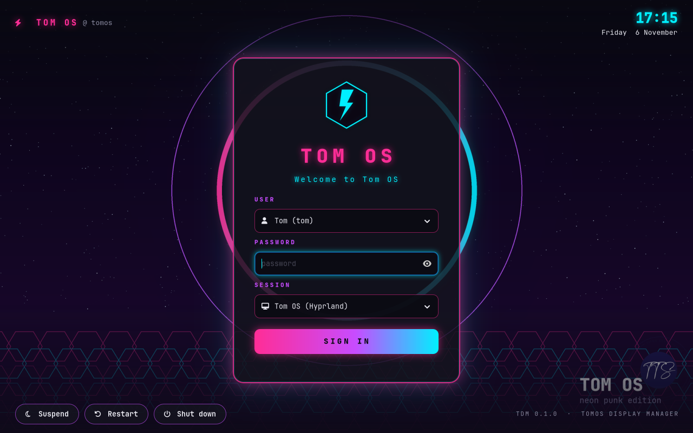
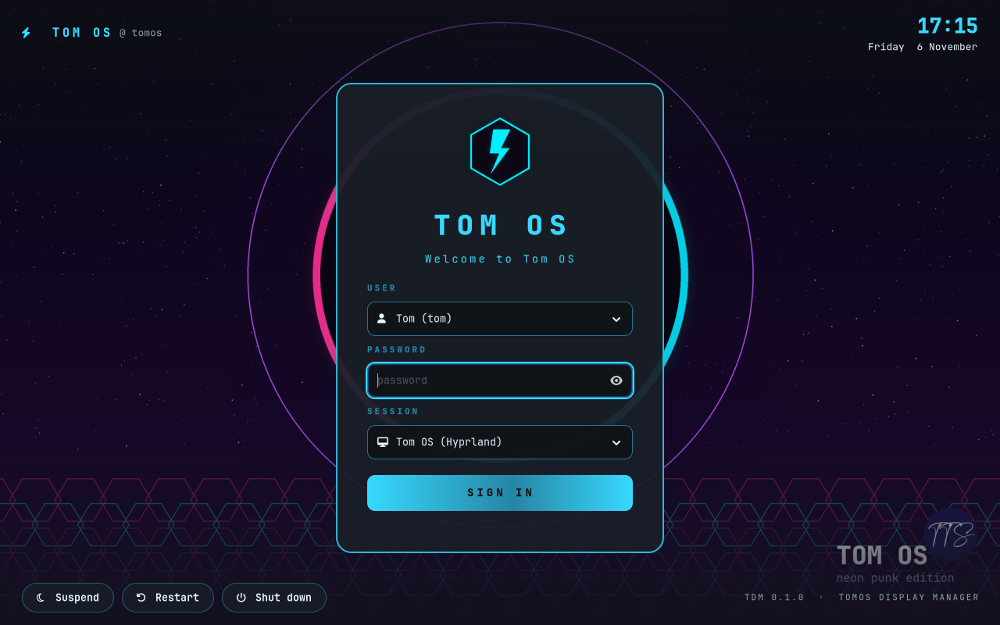
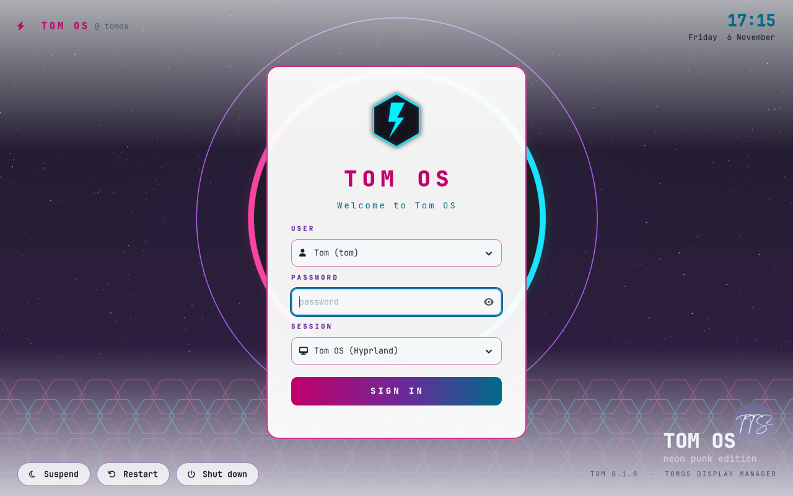
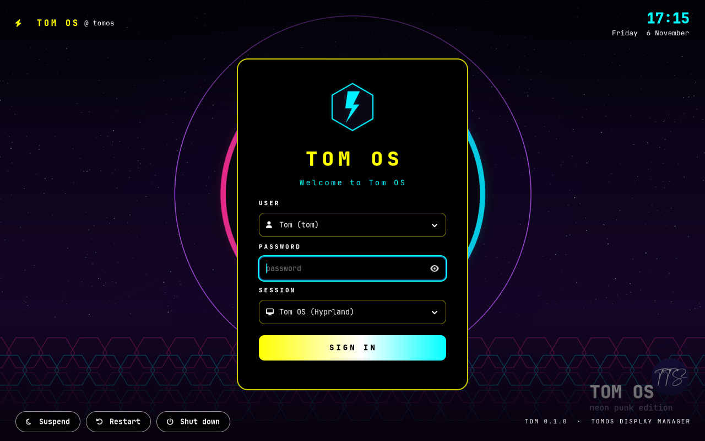
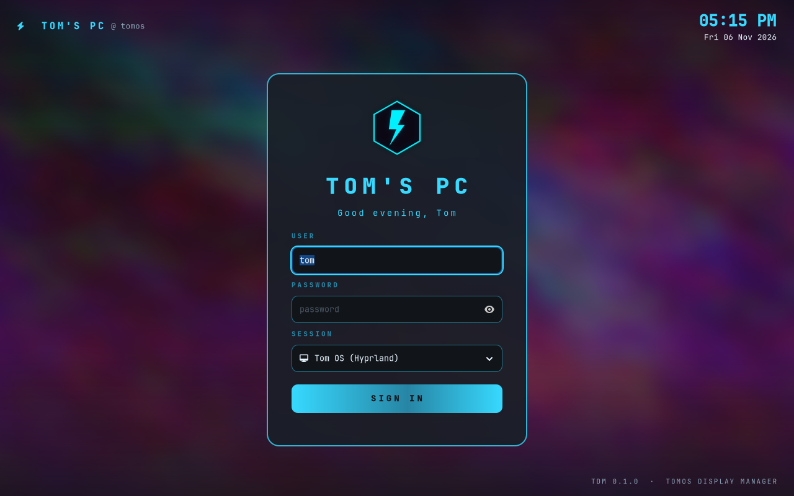
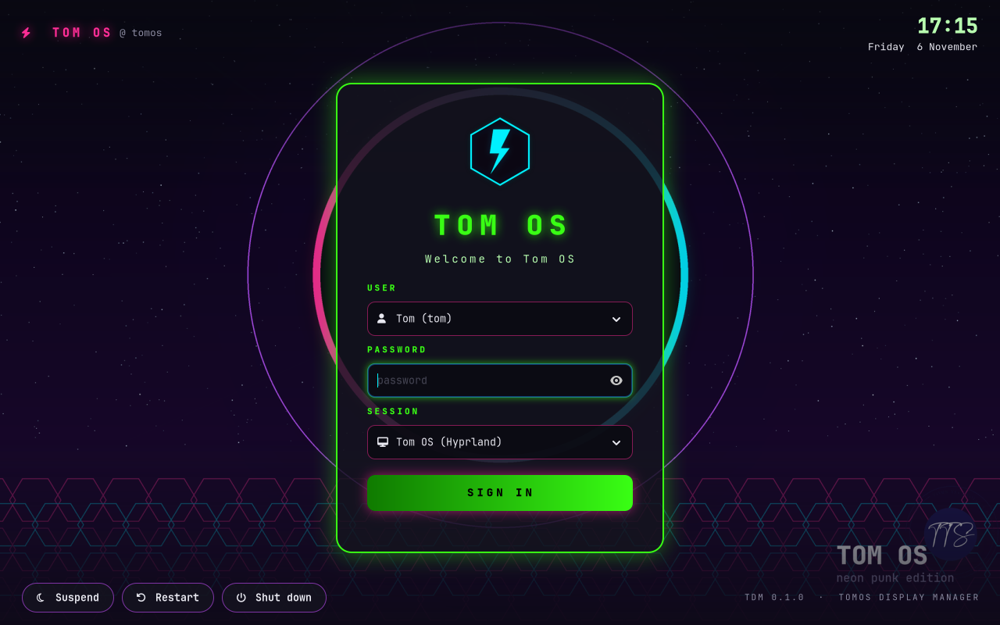

# TomOS Display Manager (TDM)

The neon login screen of **[Tom OS](https://github.com/Spruhantom/tom-os-hyperland1)**.
TDM is a GTK 4 greeter written in Rust for [greetd](https://sr.ht/~kennylevinsen/greetd/).
It runs fullscreen inside the [cage](https://github.com/cage-kiosk/cage) Wayland kiosk
compositor and uses the Tom OS branding: the Neon Eclipse wallpaper, the TOM OS logo,
pink `#ff2d96`, cyan `#00f0ff` and purple `#c74cff`, and JetBrains Mono.



[](https://github.com/Spruhantom/tomos-tdm1/actions/workflows/ci.yml)

## Install (one line)

```sh
curl -fsSL https://raw.githubusercontent.com/Spruhantom/tomos-tdm1/main/install.sh | bash
```

The installer:

1. Installs greetd, cage and GTK 4 with your package manager.
2. Downloads the prebuilt TDM, checks its SHA-256 and makes sure it runs on your system. If it can't run (another CPU type, or an older system), it builds TDM from source instead.
3. Installs TDM and sets greetd up to use it. It backs up your existing `/etc/greetd/config.toml` and keeps your `/etc/tdm/greeter.conf` if you already have one.
4. Asks before making TDM your login screen. The change takes effect at the next boot, so your current session isn't touched.

Options go after `bash -s --`:

```sh
curl -fsSL https://raw.githubusercontent.com/Spruhantom/tomos-tdm1/main/install.sh | bash -s -- --yes          # don't ask
curl -fsSL https://raw.githubusercontent.com/Spruhantom/tomos-tdm1/main/install.sh | bash -s -- --no-enable    # install only
curl -fsSL https://raw.githubusercontent.com/Spruhantom/tomos-tdm1/main/install.sh | bash -s -- --from-source  # always build
curl -fsSL https://raw.githubusercontent.com/Spruhantom/tomos-tdm1/main/install.sh | bash -s -- --uninstall    # remove
```

`--uninstall` switches back to the login screen you had before (for example GDM, SDDM or ly), restores the files it backed up and removes TDM. Your settings in `/etc/tdm` are kept.

### Supported systems

All of these except Tom OS itself are tested automatically on every change (see [How it's tested](#how-its-tested)):

| System | Package manager | Notes |
|---|---|---|
| Tom OS 26.10 | apt | TDM is already the default; the installer updates it (Tom OS is based on Ubuntu, which is tested) |
| Ubuntu 24.04 or newer | apt | needs the `universe` repository (on by default) |
| Debian 13 "trixie" or newer | apt | |
| Fedora | dnf | |
| Arch Linux | pacman | |
| openSUSE Tumbleweed | zypper | |

You need GTK 4.12 or newer and systemd. The prebuilt binary is for x86_64; on other CPUs (such as ARM64) the installer builds from source. The source build is tested on x86_64 only.

## Features

- **One form**: pick the user, type the password, press Enter. Extra login questions (one-time codes, "change your password") appear inline.
- **User picker** for normal accounts, plus "Other user…". It can be switched to a plain username box.
- **Remembers** the last user and desktop. Passwords are never stored.
- **Sessions**: lists Wayland and X11 desktops, with Tom OS first. It sets `XDG_SESSION_TYPE`, `XDG_SESSION_DESKTOP` and `XDG_CURRENT_DESKTOP`. X11 desktops are started with `startx` and hidden if xinit isn't installed.
- **Four themes**: `neon`, `dark`, `light` and `high-contrast`, plus your own CSS on top.
- **Clear messages**: "Wrong username or password.", a Caps Lock warning, and Escape to cancel.
- **Power buttons** with a confirmation (Suspend, Restart, Shut down).
- **Icons everywhere**: the bolt, user, desktop, Caps Lock and power icons come from a tiny bundled font ("TDM Icons", 3 KB, from Font Awesome 4.7 under the [SIL OFL](data/fonts/LICENSE-OFL.txt)), so they show correctly on every distro, with or without a Nerd Font.
- **Safe**: session commands are split into arguments and never run through a shell, greetd messages are size-checked, and the password is cleared straight after each attempt.

## Screenshots

| neon (default) | dark |
|---|---|
|  |  |

| light | high-contrast |
|---|---|
|  |  |

| Customised: own title, 12-hour clock, own wallpaper, no user list or power buttons | Custom CSS on top of the neon theme |
|---|---|
|  |  |

These are real screenshots of `tdm-greeter`, taken on a virtual display with `TDM_WINDOWED=1`.

## Customising

Everything is set in `/etc/tdm/greeter.conf`:

```ini
theme = neon                 # neon | dark | light | high-contrast
title = TOM OS
subtitle = Welcome to Tom OS
brand = TOM OS               # top-left label (empty hides it)
background = /usr/share/backgrounds/tomos/wallpaper-eclipse.png
logo = /usr/share/tdm/logo.png
# css = /etc/tdm/style.css   # your own GTK CSS, loaded on top of the theme
default_session = Tom OS (Hyprland)
# default_user = tom
remember = true
show_users = true
show_power = true
clock_format = %H:%M
date_format = %A %e %B
```

**[The customising guide](docs/CUSTOMISING.md)** covers every setting, the themes, your own wallpaper and logo, clock formats, custom CSS (with a list of the parts you can style), and how to preview changes in a window before you log out.

## Command line

```sh
tdm list-sessions     # desktops the greeter will offer
tdm list-users        # accounts in the user picker
tdm config            # settings exactly as TDM reads them
tdm check             # sessions, greetd setup, theme, custom CSS
tdm-greeter --print-css           # the CSS of the current theme
TDM_WINDOWED=1 tdm-greeter        # preview in a window
sudo tomos-dm tdm | ly | status   # Tom OS: switch login screen
```

## How it fits together

```
systemd ─► greetd.service (display-manager.service, VT 7)
             └─► cage -s -m last -- tdm-greeter   (greeter user: _greetd or greeter)
                    └─ greetd IPC ($GREETD_SOCK) ─► PAM ─► your desktop session
```

| Path | Purpose |
|---|---|
| `/usr/bin/tdm-greeter` | the greeter |
| `/usr/bin/tdm` | the command-line helper |
| `/usr/bin/tomos-dm` | Tom OS: switch between TDM and ly |
| `/etc/greetd/config.toml` | runs `cage … tdm-greeter` on VT 7 |
| `/etc/tdm/greeter.conf` | your settings |
| `/usr/lib/tmpfiles.d/tdm.conf` | creates `/var/lib/tdm` for the remembered user |
| `/etc/polkit-1/rules.d/50-tdm-greeter.rules` | lets the login screen suspend, restart and shut down |
| `/usr/share/tdm/logo.png` | Tom OS logo |
| `/usr/share/fonts/tdm/TDMIcons.otf` | the login screen's icons |

## Build it yourself

```sh
sudo apt install cargo rustc pkg-config libgtk-4-dev   # Rust 1.83+, GTK 4.12+
cargo test --release
cargo build --release
```

Then run `TDM_SOURCE_DIR=$PWD bash install.sh --from-source` to install your build with the same setup steps.

`examples/greetd_probe.rs` runs the exact login conversation the greeter uses against a real greetd. It was used to check Tom OS end to end: the right password starts the session as the user with `XDG_SESSION_TYPE=wayland`, and a wrong password starts nothing.

## How it's tested

Every push runs [GitHub Actions](.github/workflows/ci.yml):

- **Build and unit tests** on Ubuntu 24.04: 29 tests covering settings, users, remembered state, session parsing, full greetd conversations against a mock socket, and the theme CSS. Then the greeter is started on a virtual screen with a custom theme and CSS, and must still be running 8 seconds later.
- **The one-line installer** on clean Ubuntu 24.04, Debian 13, Fedora, Arch and openSUSE Tumbleweed systems. Each one installs, checks every file, the greetd user and that every icon is found in TDM Icons, reinstalls (your settings must survive) and uninstalls.
- **The build-from-source path** on Ubuntu 24.04. Its own Rust is too old, so this also tests the automatic Rust download.

Tagging `v*` builds the release download used by the installer ([release.yml](.github/workflows/release.yml)).

## If the login screen doesn't start

Press `Ctrl+Alt+F2`, log in on the text console and run `tdm check` and `journalctl -b -u greetd`.
To go back to your previous login screen, run the uninstaller (`… | bash -s -- --uninstall`), or on Tom OS `sudo tomos-dm ly`. Then reboot.

## Related

- [Tom OS](https://github.com/Spruhantom/tom-os-hyperland1): the distribution
- [Tomos-display-manager](https://github.com/Spruhantom/Tomos-display-manager): the original TDM 0.0.6 that this 0.1.0 rewrite is based on
- [Tom OS Installer TUI](https://github.com/Spruhantom/tomos-installer-tui): make a Tom OS USB stick from any computer

## License

MIT, see [LICENSE](LICENSE).

Created with [Perplexity](https://www.perplexity.ai/computer/tasks/ebea3e92-c3a5-4626-a883-38c9c330069a)
