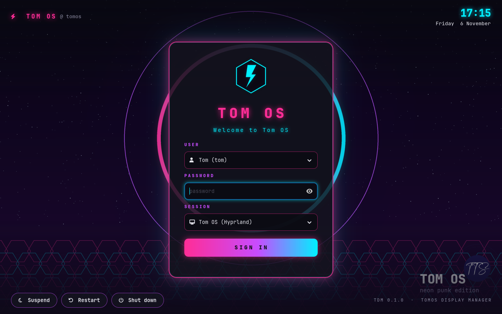
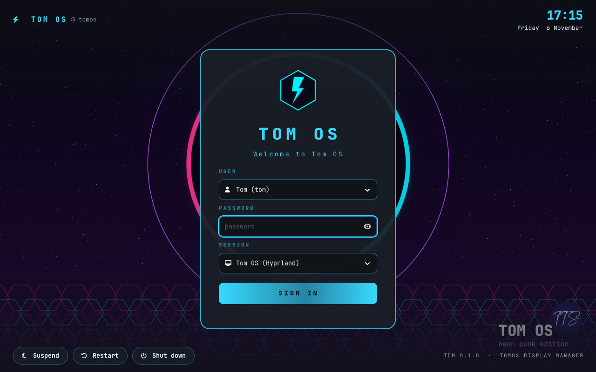
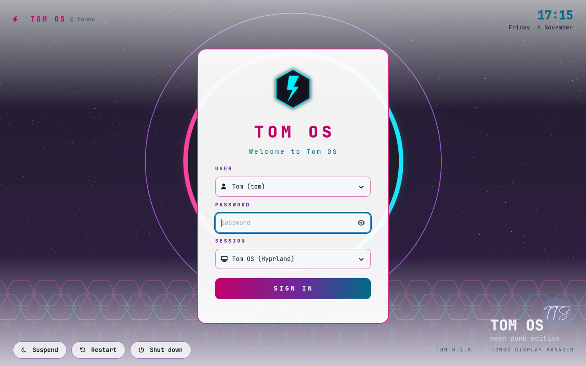
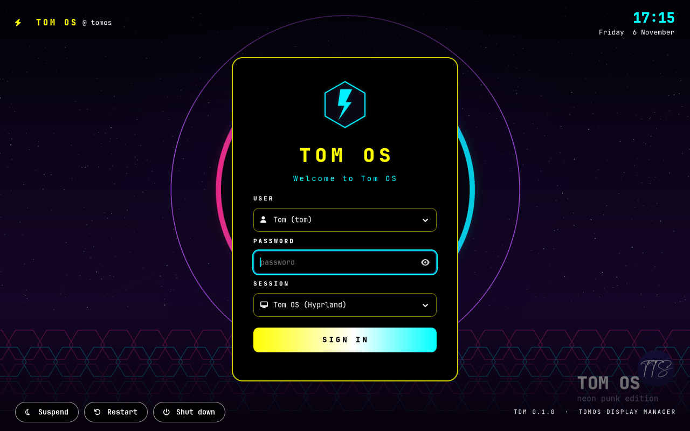
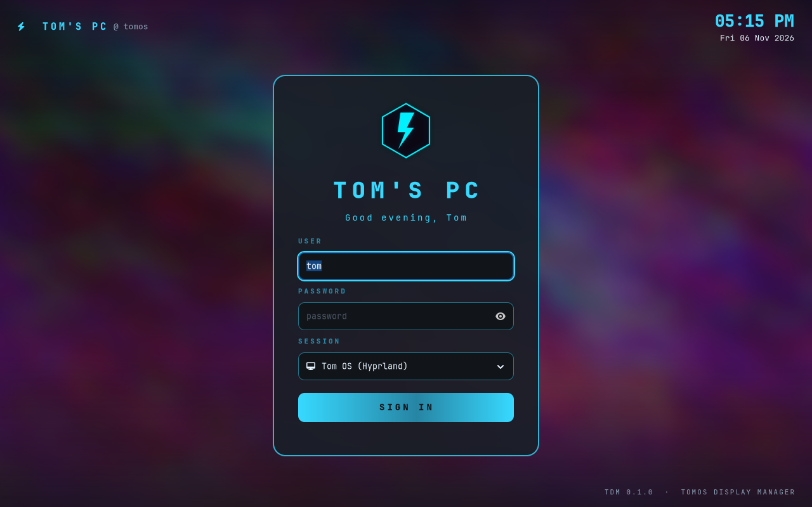
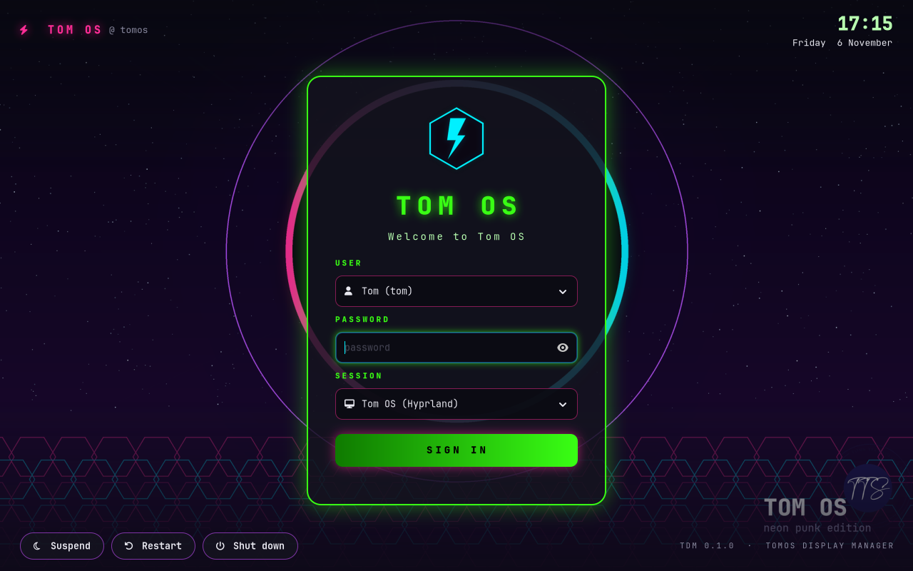
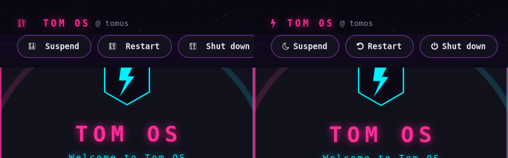

# Customising TDM

Everything about the Tom OS login screen is set in one plain text file:

```
/etc/tdm/greeter.conf
```

Edit it as root (for example `sudo nano /etc/tdm/greeter.conf`). Changes show up
the next time the login screen starts. Either log out, or restart it from a text
console (`Ctrl+Alt+F2`) with:

```sh
sudo systemctl restart greetd
```

> Restarting greetd ends every graphical session that is logged in. Save your
> work first.

You can preview changes in a window on your own desktop without logging out (see
[Preview before you log out](#preview-before-you-log-out)).

## All the settings

| Setting | Default | What it does |
|---|---|---|
| `theme` | `neon` | Colour theme: `neon`, `dark`, `light` or `high-contrast` |
| `title` | `TOM OS` | Big title on the sign-in card |
| `subtitle` | `Welcome to Tom OS` | Line under the title. Leave it empty to hide it |
| `brand` | `TOM OS` | Text in the top-left corner, after the bolt icon. Leave it empty to hide it |
| `background` | Tom OS Neon Eclipse wallpaper | Full path to the background picture (PNG, JPEG, SVG or WebP) |
| `logo` | `/usr/share/tdm/logo.png` | Full path to the logo above the title |
| `css` | not set | Full path to your own GTK CSS file, loaded on top of the theme ([see below](#your-own-colours-and-styles-css)) |
| `default_session` | first Tom OS session | Desktop picked the first time, by its menu name, e.g. `Tom OS (Hyprland)` |
| `default_user` | not set | Account picked the first time, e.g. `tom` |
| `remember` | `true` | Remember the last user and desktop (kept in `/var/lib/tdm/state`, never passwords) |
| `show_users` | `true` | `true`: choose from a list of accounts. `false`: type the username instead |
| `show_power` | `true` | Show the Suspend / Restart / Shut down buttons |
| `clock_format` | `%H:%M` | Clock format ([codes below](#clock-and-date-formats)) |
| `date_format` | `%A %e %B` | Date format |

Rules for the file:

- One `setting = value` per line. Spaces around `=` are fine.
- Lines starting with `#` or `;` are comments.
- Quotes around a value are optional: `title = "TOM OS"` works too.
- `true/false`, `yes/no`, `on/off` and `1/0` all work for on/off settings.
- Unknown settings are ignored, and a missing or broken file falls back to the defaults, so a typo can't lock you out.

## Themes

```ini
theme = neon
```

| neon (default) | dark |
|---|---|
|  |  |

| light | high-contrast |
|---|---|
|  |  |

- **neon**: Tom OS pink, cyan and purple with a glow.
- **dark**: calm blue on charcoal, no glow.
- **light**: white card with deep pink and teal.
- **high-contrast**: yellow and cyan on pure black, for easier reading.

To try a theme for one run without editing the file, set `TDM_THEME`, for example
`TDM_THEME=light`. See [Preview before you log out](#preview-before-you-log-out).

## Text, background and logo

```ini
title = TOM'S PC
subtitle = Good evening, Tom
brand = TOM OS
background = /usr/share/backgrounds/tomos/my-wallpaper.png
logo = /usr/share/tdm/my-logo.png
```

The login screen runs as the system user `_greetd`, not as you, so it **can't
read files in your home folder**. Copy pictures somewhere everyone can read:

```sh
sudo install -Dm644 ~/Pictures/my-wallpaper.png /usr/share/backgrounds/tomos/my-wallpaper.png
sudo install -Dm644 ~/Pictures/my-logo.png      /usr/share/tdm/my-logo.png
```

Tips:

- The background is scaled to fill the screen and cropped at the edges, so use a picture at least as big as your screen.
- The logo is shown 112 px high. A square PNG with a transparent background looks best.
- If a picture can't be found, TDM falls back to the Tom OS wallpaper and logo.

## Sign-in options

```ini
default_user = tom
default_session = Tom OS (Hyprland)
remember = true
show_users = false
show_power = false
```

- `show_users = false` replaces the account list with a username box. This is useful on shared computers where you don't want to show who has an account.
- `default_session` must match the name in the Session menu exactly. Run `tdm list-sessions` to see the names.
- `show_power = false` hides the power buttons. The keyboard power key still works.
- The account list shows normal accounts (UID 1000 to 59999) that have a login shell. Run `tdm list-users` to see who will be listed.



That screenshot uses this file:

```ini
theme = dark
title = TOM'S PC
subtitle = Good evening, Tom
brand = TOM'S PC
background = /usr/share/backgrounds/tomos/purple-haze.png
default_session = Tom OS (Hyprland)
default_user = tom
show_users = false
show_power = false
clock_format = %I:%M %p
date_format = %a %d %b %Y
```

## Clock and date formats

The clock updates every second. Use these codes:

| Code | Meaning | Example |
|---|---|---|
| `%H:%M` | 24-hour time | `17:09` |
| `%H:%M:%S` | with seconds | `17:09:42` |
| `%I:%M %p` | 12-hour time | `05:09 PM` |
| `%l:%M %p` | 12-hour time, no leading zero | `5:09 PM` |
| `%A %e %B` | weekday, day, month | `Friday 6 November` |
| `%a %d %b %Y` | short | `Fri 06 Nov 2026` |
| `%d/%m/%Y` | UK date | `06/11/2026` |
| `%x` | your locale's date | |

The codes are GLib's [`g_date_time_format`](https://docs.gtk.org/glib/method.DateTime.format.html)
codes, which match the usual `strftime` ones.

## Your own colours and styles (CSS)

For anything beyond the four themes, such as your own colours, fonts, corner
roundness or hiding parts of the screen, write a small GTK CSS file and point
TDM at it:

```ini
theme = neon
css = /etc/tdm/style.css
```

Your CSS is loaded **after** the theme, so your rules win. Start from a theme
that's close to what you want and only override what you need.

Example: a green "matrix" look:

```css
/* /etc/tdm/style.css */
.tdm-card   { border-color: #39ff14; box-shadow: 0 0 30px alpha(#39ff14, 0.45); }
.tdm-title  { color: #39ff14; text-shadow: 0 0 12px alpha(#39ff14, 0.85); }
.tdm-subtitle, .tdm-clock { color: #b8ffb0; text-shadow: none; }
.tdm-label  { color: #39ff14; }
button.tdm-signin { background-image: linear-gradient(90deg, #0f7a00, #39ff14); color: #000; }
.tdm-card entry:focus-within { border-color: #39ff14; box-shadow: 0 0 10px alpha(#39ff14, 0.6); }
```



### Parts you can style

| CSS selector | Part of the screen |
|---|---|
| `window.tdm` | the whole window (base colour and font) |
| `.tdm-scrim` | dark gradient over the wallpaper (top and bottom) |
| `.tdm-bar` | top and bottom bars |
| `.tdm-brand`, `.tdm-host` | top-left label and `@ hostname` |
| `.tdm-clock`, `.tdm-date` | clock and date (top right) |
| `.tdm-card` | the sign-in card |
| `.tdm-title`, `.tdm-subtitle` | title and subtitle |
| `.tdm-label` | USER / PASSWORD / SESSION labels |
| `.tdm-card entry`, `.tdm-card dropdown > button` | text boxes and menus |
| `button.tdm-signin` | the SIGN IN button (`:hover`, `:disabled`) |
| `button.tdm-ghost` | the Cancel button during extra prompts |
| `button.tdm-power` | Suspend / Restart / Shut down |
| `.tdm-status`, `.tdm-status.error`, `.tdm-status.busy` | message under the button |
| `.tdm-caps` | Caps Lock warning |
| `.tdm-footer` | `TDM 0.1.1 · TOMOS DISPLAY MANAGER` |
| `popover` | open drop-down menus |

To see the CSS a theme uses as a starting point, run:

```sh
TDM_THEME=neon tdm-greeter --print-css > ~/neon.css
```

A few things to know:

- This is GTK 4 CSS, not web CSS. Colours, borders, `border-radius`, `box-shadow`, `text-shadow`, fonts, `padding`, `margin`, `min-width` and `opacity` all work. Layout (`display`, `position`, `flex`) does not. [GTK CSS reference](https://docs.gtk.org/gtk4/css-properties.html).
- `alpha(#39ff14, 0.5)` gives a see-through colour. GTK also understands `rgba()`.
- To hide something, use `opacity: 0;`. For the host name, for example: `.tdm-host { opacity: 0; }`.
- Mistakes in the CSS are logged and that rule is skipped, so the screen still works. See the logs with `journalctl -b -u greetd`.
- The file must be readable by everyone: `sudo chmod 644 /etc/tdm/style.css`.

## Preview before you log out

You can run the greeter in a normal window on your own desktop to check a
change. It won't log anyone in: without greetd, Sign in shows "GREETD_SOCK is not set".

```sh
cp /etc/tdm/greeter.conf ~/tdm-test.conf      # then edit ~/tdm-test.conf
TDM_WINDOWED=1 TDM_CONFIG=~/tdm-test.conf TDM_STATE=/tmp/tdm-state tdm-greeter
```

| Variable | Meaning |
|---|---|
| `TDM_CONFIG` | Use this settings file instead of `/etc/tdm/greeter.conf` |
| `TDM_THEME` | Override the theme |
| `TDM_STATE` | Where to remember the last user and session (use a temporary file when testing) |
| `TDM_WINDOWED=1` | Open in a 1280x800 window instead of fullscreen |

Then check the real file before restarting the login screen:

```sh
tdm config      # shows the settings exactly as TDM reads them
tdm check       # sessions, greetd setup, theme and custom CSS
```

## Going further

- **Login screen size and screens**: greetd runs TDM inside the `cage` compositor. The command is in `/etc/greetd/config.toml`. `cage -m last` shows the login screen on the last connected monitor; use `-m extend` to span all monitors.
- **Switch back to the text login (ly)**: `sudo tomos-dm ly`. Switch back to TDM with `sudo tomos-dm tdm`.
- **Change the built-in themes**: the four palettes are near the top of `src/bin/greeter.rs` (`NEON`, `DARK`, `LIGHT`, `HIGH_CONTRAST`). Edit them and rebuild (see the README). For most changes a `css` file is easier and survives updates.

## Fonts and icons

Text uses **JetBrainsMono Nerd Font** if it's installed, then **JetBrains Mono**, then DejaVu Sans Mono.
The icons (bolt, user, desktop, Caps Lock, Suspend, Restart, Shut down) come from
**TDM Icons**, a 3 KB font that the installer puts in `/usr/share/fonts/tdm/`. They
show correctly even on systems without a Nerd Font:



To use a different font, set it in your CSS file. Keep `"TDM Icons"` in the list
so the icons still work:

```css
window.tdm { font-family: "Fira Code", "TDM Icons", monospace; }
```

If icons show as boxes, check that the icon font is installed:

```sh
fc-list ':charset=f0e7' family     # should list "TDM Icons"
```

If it doesn't, run the installer again.

## If something goes wrong

The login screen falls back to the default settings for anything it can't
read, so a mistake in `greeter.conf` won't stop you logging in. If the
screen doesn't appear at all:

1. Press `Ctrl+Alt+F2` and log in on the text console.
2. Run `tdm check` and `journalctl -b -u greetd` to see what went wrong.
3. Undo your change (for example `sudo mv /etc/tdm/style.css /etc/tdm/style.css.off`), or switch to the fallback login with `sudo tomos-dm ly`.
4. Reboot.
